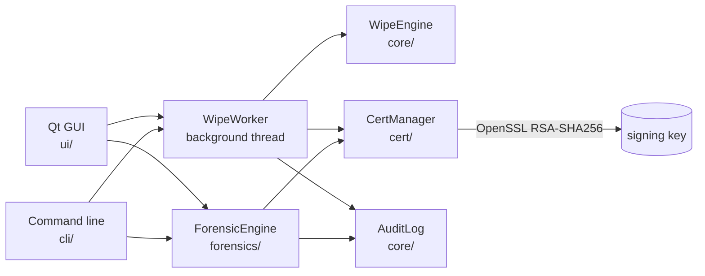

# PurgeX

**Secure data erasure, file recovery and verifiable proof, in one tool.**

PurgeX answers three questions people have about old storage devices:

- *"Is my data really gone before I sell, recycle or hand this device back?"* The erase engine overwrites files, free space and whole disks, and can issue hardware secure erase on Linux.
- *"Can I get my files back from a damaged or formatted drive?"* The recovery engine carves files from raw disks and disk images without ever writing to the source.
- *"How do I prove what was done?"* Every operation can produce a signed PDF + JSON certificate with a QR code, and every operation is written to a persistent audit history.

It ships as a desktop application (Qt) and as a scriptable command-line tool, from the same executable.

---

## Contents

- [Features](#features)
- [How it works](#how-it-works)
- [Erasure](#erasure)
- [File recovery](#file-recovery)
- [Certificates and verification](#certificates-and-verification)
- [Audit history](#audit-history)
- [Build and install](#build-and-install)
- [Using PurgeX](#using-purgex)
- [Where PurgeX keeps its data](#where-purgex-keeps-its-data)
- [Platforms](#platforms)
- [Safety design](#safety-design)
- [Testing](#testing)
- [Project layout](#project-layout)

---

## Features

| Area | What you get |
|------|--------------|
| **Erase** | Files, folders (recursive), free space and entire physical disks. Patterns: zero, one, random, alternating, NIST SP 800-88 1/3/7-pass, Gutmann 35-pass. Optional read-back verification. |
| **Hardware erase** | ATA Security Erase and NVMe format on Linux, with safeguards for frozen drives and leftover passwords. |
| **Recover** | Read-only signature carving of raw devices and disk images, plus identification and copy of files in a folder. 20 file formats, length detection from each format's own structure, SHA-256 per recovered file. |
| **Prove** | Signed PDF + JSON certificates with a Device Passport (CPU, memory, drive model and serial), an embedded public key and a QR code. Verify the file or a scanned QR code in the GUI and CLI. |
| **Audit** | Persistent history of every wipe and recovery (success, failure or cancellation), searchable and filterable. |
| **Two interfaces** | Tabbed GUI (One-Click, Advanced, Drives, File Recovery, Certificates, Audit) and a full CLI. |
| **Offline** | No network access of any kind. |

---

## How it works



- **`WipeEngine`** detects drives, generates overwrite patterns, wipes files / free space / disks, runs hardware erase and verifies results.
- **`WipeWorker`** runs a complete job (wipe, verify, certificate, audit entry) off the UI thread. The GUI and the CLI both use it, so they behave identically.
- **`ForensicEngine`** reads a source through a sector-aligned, read-only reader and carves recognised files into a destination folder.
- **`CertManager`** builds the canonical document, hashes and signs it with OpenSSL, renders the PDF and QR code, and verifies certificates.
- **`AuditLog`** keeps the JSON history, written atomically.

---

## Erasure

### Patterns

| Pattern | Passes | Content |
|---------|:------:|---------|
| Zero / One / Random / Alternating | as requested | `0x00`, `0xFF`, OS CSPRNG, `0x55`/`0xAA` (swapped each pass) |
| NIST SP 800-88 (1 pass) | 1 | zeros (Clear) |
| NIST SP 800-88 (3 passes) | 3 | zeros, ones, random (Purge-style) |
| NIST SP 800-88 (7 passes) | 7 | zeros, ones, random, zeros, ones, random, random |
| DoD 5220.22-M style (3 / 7 passes) | 3 / 7 | CLI aliases `dod3` and `dod7` for the same sequences as the NIST 3- and 7-pass patterns |
| Gutmann | 35 | Gutmann's published sequence: 4 random, 27 fixed patterns, 4 random |

Fixed-sequence patterns always run their full pass count, whatever number is requested. The certificate records the passes that were really performed.

### Targets

- **Files and folders**: each file is overwritten in place, flushed to disk, truncated, given a random name, and deleted. Folders are processed recursively and removed afterwards. Symbolic links and junctions are removed, never followed. With *Verify* on, the final pass is hashed while written and compared with a read-back hash.
- **Free space**: temporary files fill the volume with the pattern for each pass, then are deleted. About 16 MB is left untouched so the system stays usable.
- **Full disk**: overwrites the whole physical disk that holds the selected volume, every partition included. On Windows, all volumes on the disk are locked and dismounted first. PurgeX **refuses** to wipe the disk that runs the operating system.
- **Hardware secure erase** (Linux): ATA Security Erase (enhanced when available) via `hdparm`, or NVMe user-data erase via `nvme-cli`. Requires root and a drive that is not frozen.

### SSDs

Overwriting an SSD from the host cannot reach every flash cell (wear-levelling, over-provisioning, TRIM). PurgeX detects flash storage, warns before host-level wipes, and records the limitation in the certificate. Use hardware secure erase for SSD sanitisation. 

---

## File recovery

Two modes, both strictly read-only on the source:

| Mode | Source | Use it for |
|------|--------|------------|
| **Logical** | A folder | Identify files by content, ignoring extensions, and copy them out (for example a damaged folder or the Recycle Bin). |
| **Raw** | A physical disk, a volume, or a disk image (`.img`, `.dd`, `.raw`, ...) | Find files that are no longer in any directory: deleted, formatted or corrupted media. |

### How raw carving works

1. The source is read in sector-aligned 1 MiB blocks (raw devices reject unaligned reads). Unreadable regions of damaged media are zero-filled, counted and reported instead of aborting the scan.
2. Files start on sector boundaries, so only 512-byte sector starts are tested. This removes almost all false positives.
3. A hit must pass a structural check (for example a real BMP header, a valid PE header, an `ftyp` box) before it is carved.
4. The end of the file is found from the format itself:

   | Format | Length is taken from |
   |--------|----------------------|
   | JPEG | Segment walk to the real end-of-image marker (embedded EXIF thumbnails no longer cut files short) |
   | PNG, GIF | Chunk / block walk to the trailer |
   | ZIP, DOCX, XLSX, PPTX | End-of-central-directory record that matches the archive start |
   | PDF | `%%EOF` marker |
   | WAV, AVI, WebP | RIFF size field |
   | BMP | Header size field |
   | MP4 | Top-level box walk |
   | 7-Zip, SQLite, PE (`.exe`/`.dll`) | Header and section fields |
   | RAR, GZip, MP3, FLAC, OLE2 documents, XML | Not derivable: carved up to a size cap and marked *Medium/Low* confidence |

5. Each recovered file is written to the destination named `recovered_<n>_off<hex offset>.<ext>`, with its SHA-256. Results are graded **Recovered / Partial** and **High / Medium / Low** confidence. Only files with a proven length are reported as complete.

The destination must be on a different disk than the source. PurgeX checks this and refuses to start otherwise.

---

## Certificates and verification

Each certificate is a matched pair under `certificates/pdfs` and `certificates/json`:

- **PDF**: human-readable summary, SHA-256, signature, signer fingerprint and a QR code whose payload is `<sha256 hex>_PurgeX`.
- **JSON**: the same data plus the signer's public key, ready for automated checks.
- **Device Passport**: the machine (OS, CPU, memory, host name) and the target drive (model, serial, type, size) are recorded in the certificate and covered by the signature, so they cannot be edited afterwards.

**What is signed.** The compact JSON of `{bytesProcessed, device, method, subject, targets, timestamp}` (keys sorted, UTF-8; `device` is included when present) is hashed with SHA-256 and signed with RSA-2048 / SHA-256 (PKCS#1 v1.5) by OpenSSL.

**Verification** (GUI *Certificates* tab or `PurgeX --verify-cert file.json`) succeeds only when both hold:

1. the content hash matches the stored hash and QR payload, and
2. the RSA signature is valid for the embedded public key.

A matching hash alone is never accepted, because anyone can recompute a hash. The result also shows the signer's key fingerprint and whether the key belongs to this installation, so a recipient can compare the fingerprint with the issuer's published one. A certificate signed by an unknown key is internally consistent but only as trustworthy as that fingerprint.

**Scanning the QR code.** The Certificates tab (*Verify Scanned QR*) and `PurgeX --verify-cert file.json --qr "<scanned text>"` check that a scanned QR payload belongs to a certificate and that the certificate itself is authentic.

The signing key pair is created on first use (see [data locations](#where-purgex-keeps-its-data)). On Windows the private key is encrypted with DPAPI, so only the same Windows user on the same machine can use it; on Linux it is a file readable only by its owner.

Failed and cancelled operations are never certified.

---

## Audit history

Every wipe and every recovery scan is recorded, whether or not a certificate was requested: time, type, target, method, status (`success`, `failed`, `cancelled`, `partial`), verification result, bytes processed and certificate path. The *Audit History* tab filters by type, status, date and free text, shows details and opens the certificate. The log is written atomically, and an unreadable log is preserved as `audit_log.json.corrupt-<time>` rather than overwritten.

---

## Build and install

### Requirements

- A C++17 compiler
- **Qt** (Widgets, PrintSupport)
- **OpenSSL** development files (`libcrypto`)

### Windows (MSYS2)

```bash
# In an MSYS2 UCRT64 shell
pacman -S mingw-w64-ucrt-x86_64-toolchain mingw-w64-ucrt-x86_64-qt5-base \
          mingw-w64-ucrt-x86_64-qt5-tools mingw-w64-ucrt-x86_64-openssl
```

```cmd
build.bat
```

This compiles the app, runs `windeployqt` and copies the OpenSSL runtime next to `release\PurgeX.exe`. The folder is self-contained.

### Linux

```bash
sudo apt install build-essential qtbase5-dev qt5-qmake libssl-dev   # Debian / Ubuntu
./build.sh
```

Raw disk access (full-disk wipe, hardware erase, device recovery) needs root.

### CMake

```bash
cmake -S . -B build && cmake --build build
```

## Platforms

PurgeX runs on **Windows 10/11** and **Linux** desktops. Everything in this document is available on both, except hardware secure erase, which uses Linux tools (`hdparm`, `nvme-cli`); on Windows the full-disk overwrite is the whole-disk method. Whole-disk and raw-device operations need Administrator / root.

---

## Using PurgeX

### GUI

Run `PurgeX` with no arguments.

| Tab | Purpose |
|-----|---------|
| **One-Click Wipe** | Pick files or a folder; wipes with NIST 3-pass, verification and a certificate. |
| **Advanced Mode** | Choose pattern, passes, verification and certificate; mix files and folders. |
| **Drive Wiping** | See detected drives (type, model, serial, physical disk), wipe free space, wipe a whole disk, or run hardware secure erase. Whole-disk operations need Administrator / root and a typed confirmation. |
| **File Recovery** | Choose a folder, device or disk image and a destination; scan, review results, open files, export a signed report. |
| **Certificates** | Verify a certificate; open the certificate and log folders. |
| **Audit History** | Browse and filter past operations. |

Cancelling an operation stops it between chunks. Closing the window during a wipe asks first.

### Command line

Any argument switches to CLI mode. On Windows, run it from a terminal; output is attached to that console or to your redirection.

```text
PurgeX --files a.txt b.txt --pattern nist3 --verify --certificate
PurgeX --folder D:\old-project --pattern gutmann --certificate
PurgeX --drive E: --free-space --pattern random --passes 2
PurgeX --drive E: --full-drive --pattern nist3        # asks you to type YES (or pass --yes)
PurgeX --secure-erase /dev/nvme1n1                    # Linux, root
PurgeX --list-drives
PurgeX --verify-cert certificate.json

PurgeX --recover D:\evidence\disk.img --raw --output F:\recovered
PurgeX --recover C:\Users\me\old-folder --output F:\recovered --types image,document
```

| Option | Meaning |
|--------|---------|
| `--pattern` | `zero`, `one`, `random`, `alternating`, `nist1`, `nist3` (default), `nist7`, `gutmann` |
| `--passes N` | Passes for `zero`/`one`/`random`/`alternating`; NIST and Gutmann fix their own count |
| `--verify` | Read back and verify (files, folders) or probe-check (free space) |
| `--certificate` | Write a signed PDF + JSON certificate |
| `--yes` | Skip the typed confirmation for whole-disk operations |
| `--verbose` | One line per progress update |
| `--raw`, `--output`, `--types` | Recovery options (see `--help`) |

Press Ctrl+C to cancel safely. **Exit codes:** `0` success, `1` failed or cancelled, `2` invalid usage.

---

## Where PurgeX keeps its data

| Data | Default location |
|------|------------------|
| Certificates | `Documents/PurgeX/certificates/{pdfs,json}` |
| Audit history | `Documents/PurgeX/audit_log.json` |
| Session logs | `Documents/PurgeX/logs` |
| Signing keys | `AppData/Roaming/PurgeX/PurgeX` (Windows), `~/.local/share/PurgeX/PurgeX` (Linux) |

Set the `PURGEX_HOME` environment variable to relocate everything into one folder (keys go to `PURGEX_HOME/keys`). The test suite uses this to stay out of real user data.

---

## Safety design

- The system disk is never wiped, and the physical disk behind a volume is resolved from the operating system rather than guessed.
- Recovery never writes to the source, and refuses a destination on the disk being scanned.
- Whole-disk operations require elevated rights and a typed confirmation; the CLI needs `YES` or `--yes`.
- Cancellation never kills a thread, so no engine is left half-locked.
- Hardware erase removes its temporary ATA password if the erase fails.
- Symbolic links are removed, not followed.

---

## Testing

```bash
cd tests
qmake tests.pro && make                 # mingw32-make on Windows
./PurgeXTests -o results.txt,txt        # tests\release\PurgeXTests.exe on Windows
```

QtTest prints nothing to a redirected console on some Windows setups, so writing to a file with `-o` is the reliable way to read the result. Set `PURGEX_TEST_LOG_DIR` to a folder to get one log file per suite.

The suite (50 checks) covers pattern generation, file and folder wiping, cancellation, the worker pipeline, the audit log, carving of a synthetic disk image (including a JPEG with an embedded thumbnail, a truncated PNG and look-alike signatures), the recovery safety gates, and certificate signing, tampering and forgery. Tests run against a temporary `PURGEX_HOME` and never touch real drives.

---

## Project layout

```text
main.cpp                 Entry point: GUI, or CLI when arguments are given
core/                    WipeEngine (patterns, wiping, drives), AuditLog, AppPaths
forensics/               ForensicEngine (carving) and FileSignatures (format table)
cert/                    CertManager (OpenSSL signing, PDF/JSON) and a bundled QR encoder
cli/                     CLIManager (command-line interface)
ui/                      MainWindow tabs, ForensicWidget, AuditWidget
tests/                   QtTest suite
build.bat / build.sh     Build helpers (qmake); CMakeLists.txt for CMake
```

---
